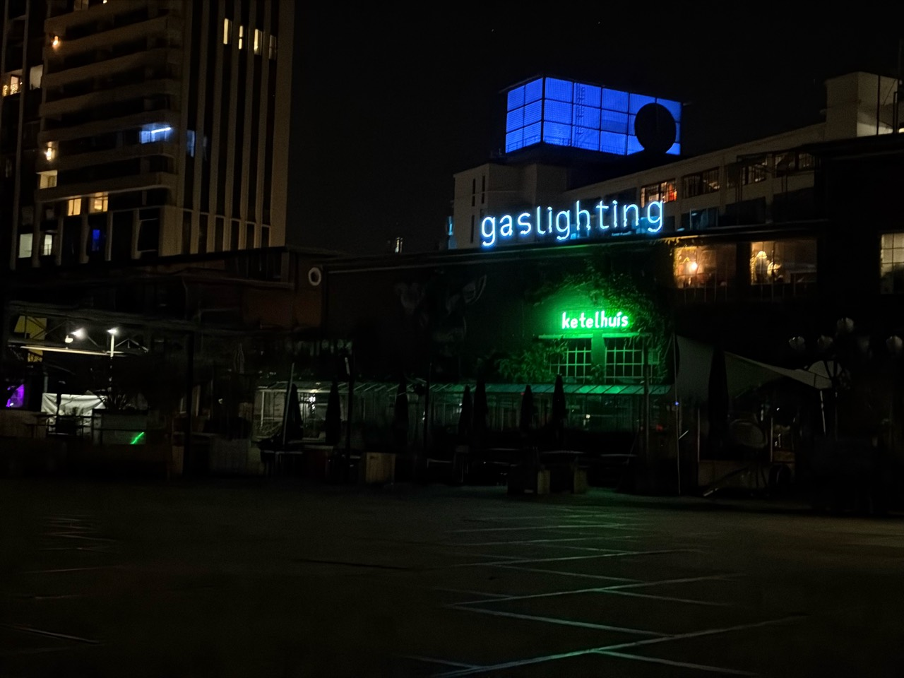
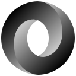
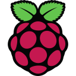
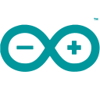

<h1 align="left">Lorenzo Lombardi</h1>

  

  <strong>Software Engineer · Industrial Automation · Industrial Networking</strong>

---

**Industrial software & automation**  
↳ Developing and integrating software for PLC-based control, monitoring, and HMI systems  
↳ Working with industrial communication protocols, network diagnostics, and commissioning

**Systems & engineering**  
↳ Exploring embedded devices, Linux-based tooling, and self-hosted infrastructure

## Tools & technologies

<strong>Programming &amp; scripting</strong>

  &nbsp;C
  &nbsp;&nbsp;
  &nbsp;C++
  &nbsp;&nbsp;
  &nbsp;Python
  &nbsp;&nbsp;
  &nbsp;PowerShell
  &nbsp;&nbsp;
  

<strong>Web &amp; data formats</strong>

  &nbsp;HTML
  &nbsp;&nbsp;
  &nbsp;CSS
  &nbsp;&nbsp;
  &nbsp;JSON

<strong>Backend frameworks</strong>

  <a href="https://flask.palletsprojects.com/"><picture><source media="(prefers-color-scheme: dark)" srcset="./icone/flask-dark.svg" /></picture></a>&nbsp;Flask

<strong>Databases</strong>

  &nbsp;SQLite
  &nbsp;&nbsp;
  &nbsp;MySQL

<strong>Embedded platforms &amp; tools</strong>

  &nbsp;Raspberry&nbsp;Pi
  &nbsp;&nbsp;
  &nbsp;ESP32&nbsp;/&nbsp;ESP-IDF
  &nbsp;&nbsp;
  &nbsp;Arduino&nbsp;IDE
  &nbsp;&nbsp;
  &nbsp;PlatformIO

<strong>Operating systems</strong>

  &nbsp;Linux
  &nbsp;&nbsp;
  &nbsp;Windows

<strong>Development &amp; deployment</strong>

  &nbsp;Git
  &nbsp;&nbsp;
  &nbsp;Docker

<strong>Networking &amp; diagnostics</strong>

  &nbsp;Wireshark
  &nbsp;&nbsp;
  
  &nbsp;&nbsp;
  
  &nbsp;&nbsp;
  
  &nbsp;&nbsp;
  
  &nbsp;&nbsp;
  

---

  

  

<a href="https://github.com/lorenzolombardii">GitHub</a>

